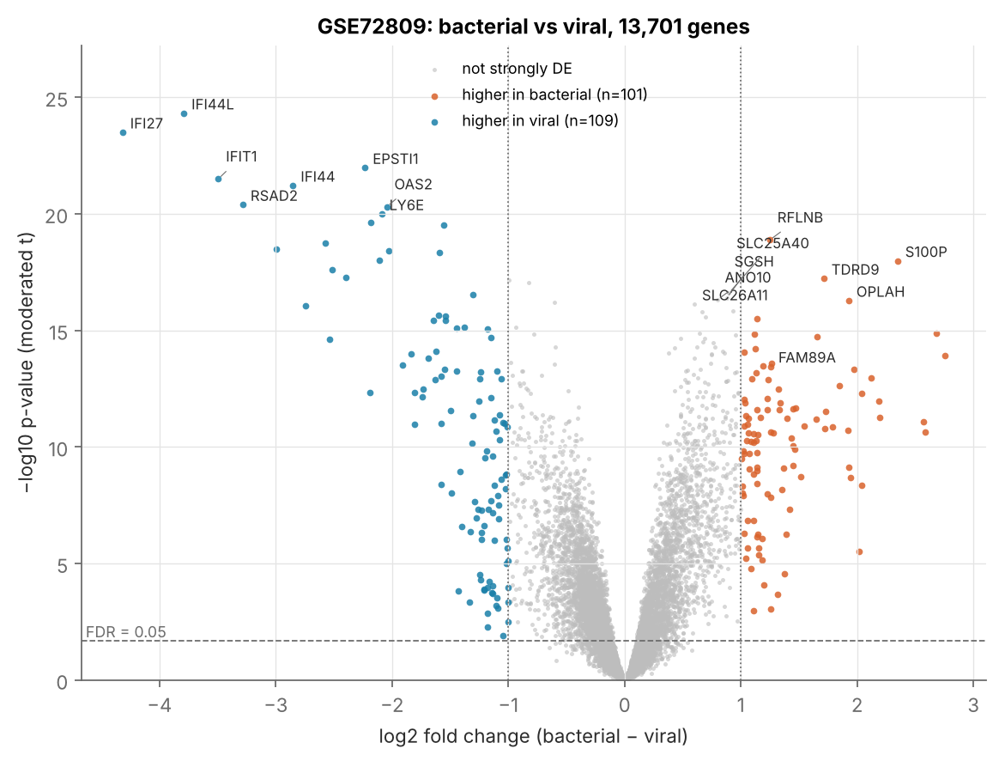
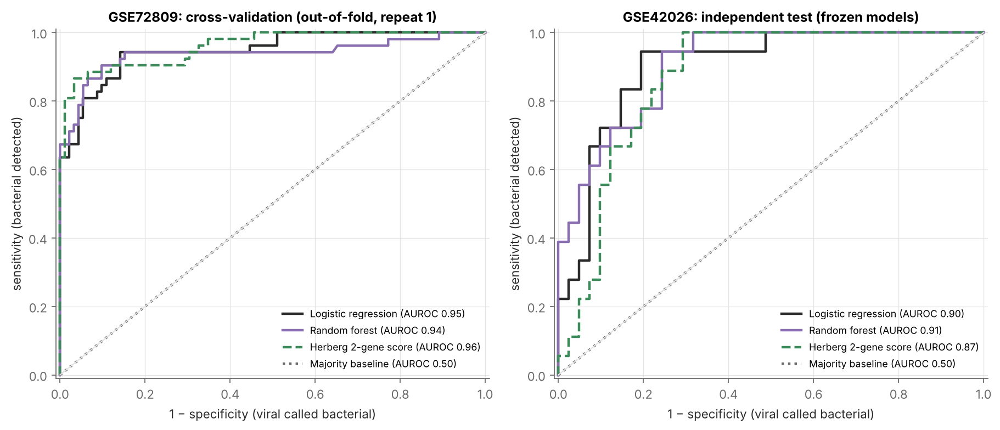

# Bacterial versus viral infection in children — host blood gene expression

**Group Nine · Computing for Bioinformatics (ICS 4301) · Strathmore University · November 2026**

[](https://colab.research.google.com/github/Karashee/group9-bacterial-viral-infection/blob/main/Group9_Bacterial_vs_Viral_Infection.ipynb)

## Research question

Which blood genes and pathways differ between children with confirmed bacterial and confirmed viral infections, and
can these differences classify infection type in an independent dataset?

| # | Objective | Notebook section |
|---|---|---|
| 1 | Quality-check and explore the data | 3–4 |
| 2 | Identify differentially expressed genes and pathways | 5–6 |
| 3 | Compare a classifier with a baseline | 7 |
| 4 | Test performance on an independent dataset and explain limitations | 7–8 |

Question, objectives and data plan are as agreed in the group's meeting minutes of 28 October and 4 November 2026.

## Key results

| Finding | Result |
|---|---|
| Genes differing (FDR < 0.05) | **5,760** of 13,701 tested; **210** differ at least two-fold (101 higher in bacterial, 109 higher in viral) |
| Top viral genes | *IFI44L*, *IFI27*, *EPSTI1*, *IFIT1*, *IFI44*, *RSAD2* (type I interferon response) |
| Top bacterial genes | *MMP8*, *IL1R2*, *S100P*, *PI3*, *OPLAH*, *FAM89A* (neutrophil / inflammatory response) |
| Pathways | Viral: type I interferon signalling, defence response to virus. Bacterial: neutrophil degranulation, defence response to bacterium |
| Replication in GSE42026 | 68% of strongly DE genes replicate (same direction, p < 0.05); fold-change correlation r = 0.75 |
| Classifier, cross-validation (GSE72809) | Logistic regression AUROC 0.94, random forest 0.94; majority baseline 0.50 |
| Classifier, independent test (GSE42026) | Logistic regression **AUROC 0.90 (95% CI 0.81–0.97)**, balanced accuracy 0.82; 15/18 bacterial and 33/41 viral infections correctly classified |
| Main limitations | Small test cohort (18 bacterial, all Gram-positive); definite cases only; sex imbalance and no age data; not tested in Kenyan children |




## Data

| Role | Dataset | Platform | Used samples |
|---|---|---|---|
| Discovery (differential expression, model development) | [GSE72809](https://www.ncbi.nlm.nih.gov/geo/query/acc.cgi?acc=GSE72809) | Illumina HumanHT-12 V4 (GPL10558) | 52 definite bacterial, 92 definite viral (of 292 arrays) |
| Independent test (touched once, after the model was frozen) | [GSE42026](https://www.ncbi.nlm.nih.gov/geo/query/acc.cgi?acc=GSE42026) | Illumina HumanHT-12 V3 (GPL6947) | 18 bacterial, 41 viral: 19 H1N1/09, 22 RSV (of 92 arrays) |

Supporting files, downloaded by the notebook from pinned commits and checked by SHA-256:
probe → gene annotation exported from Bioconductor `illuminaHumanv4.db` 1.26.0, Enrichr *GO Biological Process 2021*
and MSigDB *Hallmark* v7.0 gene sets.

Healthy controls and probable or uncertain cases are excluded from the primary two-class comparison. The two chips are
matched probe by probe (identical Illumina probe IDs), not by gene name.

## How to run

1. Click **Open in Colab** above (or upload the notebook to Colab).
2. *Runtime → Run all.* The notebook downloads the GEO series-matrix files and the three supporting files itself.
3. A CPU runtime is enough; the full run takes about 3–5 minutes. All random steps use `SEED = 9`.

To run locally: `pip install -r requirements.txt jupyter`, then open the notebook from the repository root.

## Repository layout

```
Group9_Bacterial_vs_Viral_Infection.ipynb   the analysis, with outputs saved (stages 1–8 of the brief)
figures/                                    every figure the notebook draws (PNG)
results/                                    every results table (CSV) and summary.json
requirements.txt                            packages (all preinstalled on Colab)
nb_src/analysis.py                          plain-text source of the notebook (jupytext percent format)
data/raw/                                   created at run time for downloads (not committed)
```

## Methods in one paragraph

Series-matrix values were checked for scale and normalisation, filtered to probes expressed above the dataset median in
at least as many arrays as the smaller class, annotated with unambiguous gene symbols and collapsed to one probe per
gene. Sex genes (*XIST* vs Y-chromosome genes) were used to check sample labels. Differential expression used a
limma-style moderated t-test (empirical Bayes, implemented in NumPy) with Benjamini–Hochberg FDR control, and was
replicated in the independent cohort. Over-representation analysis (hypergeometric test, filtered-gene background) and
a NetworkX co-expression network were used for biological interpretation, alongside two published signatures (Herberg
2016, Sweeney 2016). Classifiers were evaluated with nested, repeated, stratified cross-validation, with feature
selection inside the folds, then frozen and tested once on GSE42026 with bootstrap confidence intervals.

## Team

| Member | Student no. | Stage led |
|---|---|---|
| Kelvin Murega | 166914 | Research question, objectives, hypothesis, lecturer approval |
| Deborah Rehana | 168656 | Data acquisition, documentation, cross-platform feature mapping |
| Andrew Karanja | 167144 | Preprocessing, quality control, exploratory data analysis |
| Jeremy Kang'ethe | 166263 | Differential expression with FDR correction |
| Eric Lenina | 161492 | Biological interpretation (enrichment, literature) |
| Eric Muthii | 166390 | Machine learning, independent validation, limitations |

## Responsible use

This is a research analysis of public, de-identified data. It is not a diagnostic test and must not be used to make
treatment decisions for any child. Performance in Kenyan children has not been tested.

## References

* Herberg JA *et al.* *JAMA* 2016;316(8):835–845 (GSE72809).
* Herberg JA *et al.* *J Infect Dis* 2013;208(10):1664–1668 (GSE42026).
* Sweeney TE, Wong HR, Khatri P. *Sci Transl Med* 2016;8(346):346ra91.
* Smyth GK. *Stat Appl Genet Mol Biol* 2004;3:Article 3.
